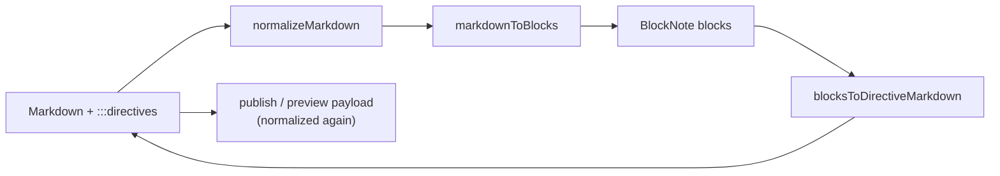

# Markdown Content Pipeline

Editorial content is stored as Markdown enriched with **container directives** (`remark-directive`). The editor (BlockNote) works on JSON blocks; the pipeline converts between the two.



## Key Files (`apps/frontend/src`)

| File | Role |
|------|------|
| `lib/markdown/parser.ts` | `markdownToBlocks()`: strips YAML frontmatter (`gray-matter`), normalizes fences, parses with `remark-parse` + `remark-gfm` + `remark-directive`, converts AST nodes to BlockNote blocks (`nodeToBlock`, `parseDirective`), then cleans stray `:::` lines (`validateAndFixBlocks`). |
| `lib/markdown/serializer.ts` | `blocksToDirectiveMarkdown()`: BlockNote blocks → MDAST (`blocksToMdast` / `blockToMdast`) → `remark-stringify`, with a custom `containerDirective` handler for `:::` fences. |
| `lib/markdown/normalizeMarkdown.ts` | Rewrites directive fences to depth-based lengths (see below). |
| `components/document-editor/editor/blocks/custom-schema.ts` | BlockNote schema: custom `callout` block (`variant` `important` or `goodToKnow`); toggles use the native `toggleListItem`. |

## Supported Directives

| Markdown | BlockNote block |
|----------|-----------------|
| `:::toggle{title="..."}` | `toggleListItem` (title becomes the inline content) |
| `:::important` | `callout`, `variant: "important"` |
| `:::good-to-know` | `callout`, `variant: "goodToKnow"` |

Tables, images and bullet/numbered/check lists are also handled by both parser and serializer.

## Fence Normalization (nesting)

The editor writes **flat** Markdown: every fence is `:::`, without indentation, so nested directives are ambiguous (which `:::` closes which block?).

`normalizeMarkdown()` rewrites fences by nesting depth: root = 12 colons, each level one fewer, down to 3. A closing fence must be at least as long as its opening fence, so an inner closing fence can never close an outer block.

```markdown
::::::::::::toggle{title="..."}
:::::::::::important
Content
:::::::::::
::::::::::::
```

Best effort: lines inside code blocks (```` ``` ```` / `~~~`) are left untouched, unbalanced fences are left as-is.

Normalization runs:
- on import, inside `markdownToBlocks()`;
- on output to Réfugiés.info: `publishDocument()` (`services/document-actions.ts`) and the preview payloads in `lib/payload-builder.ts`, which pass `normalizeMarkdown` to `buildRefugiesInfoPayload()` (`packages/shared/src/lib/publication/refugies-info.ts`).

## Adding a Directive Block

1. Add the block spec to `custom-schema.ts`.
2. Map the directive name to the block in `parseDirective()` (`parser.ts`).
3. Add the block case to `blockToMdast()` (`serializer.ts`), and to the `containerDirective` handler if it needs specific output.
4. Cover it in `apps/frontend/tests/lib/markdown/parser.test.ts` and `serializer.test.ts`.
